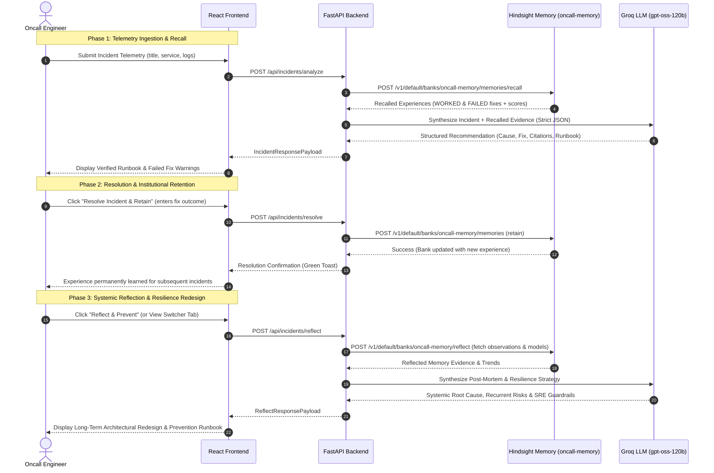

# 🛡️ OnCall Memory
### *Memory-Augmented Autonomous Incident Triage & Diagnostics*

> **"When production breaks, the agent doesn't start from zero."**

[](file:///c:/Users/kawsi/OneDrive/Desktop/Hack_with_hyderabad/docker-compose.yml)
[](https://fastapi.tiangolo.com)
[](https://react.dev)
[](https://www.typescriptlang.org)
[](https://github.com/vectorize-io/hindsight)
[](https://groq.com)

---

## 📋 Table of Contents
1. [Executive Overview & Problem Statement](#-executive-overview--problem-statement)
2. [Key Capabilities](#-key-capabilities)
3. [System Architecture](#-system-architecture)
4. [Complete Tech Stack](#-complete-tech-stack)
5. [Database & Storage Architecture](#-database--storage-architecture)
6. [Hindsight Agent Memory Deep Dive](#-hindsight-agent-memory-deep-dive)
7. [Docker Deployment Guide (Recommended)](#-docker-deployment-guide-recommended)
8. [Local Step-by-Step Development](#-local-step-by-step-development)
9. [Environment Variables Reference](#-environment-variables-reference)
10. [The Two-Stage Learning Live Demo Walkthrough](#-the-two-stage-learning-live-demo-walkthrough)
11. [Complete REST API Specification](#-complete-rest-api-specification)
12. [Automated Testing & Verification](#-automated-testing--verification)
13. [Troubleshooting & FAQs](#-troubleshooting--faqs)

---

## 🎯 Executive Overview & Problem Statement

When high-severity incidents fire in production, oncall engineers are forced to reinvent the wheel:
* **The "Groundhog Day" Trap**: Past incident tickets are buried in disparate silos (Jira, Slack threads, Confluence runbooks, post-mortems).
* **Repeating Costly Mistakes**: Engineers often try quick remedies (e.g. restarting pods) that historically **failed** and merely delayed or worsened recurring crash loops.
* **Cold-Start Latency**: New or junior oncall engineers lack the institutional memory required to diagnose subtle leaks, pool exhaustions, or dependency timeouts rapidly.

### The Solution
The **Incident Response Agent** is an autonomous, memory-augmented oncall co-pilot:
1. **Recalls Past Incidents**: Upon receiving an incident telemetry payload, it queries an active [Hindsight](https://github.com/vectorize-io/hindsight) memory bank (`oncall-memory`) using multi-strategy **TEMPR** retrieval.
2. **Distinguishes Worked vs. Failed Remedies**: It explicitly surfaces which remedies historically worked and warns against actions that previously failed.
3. **Reasons with Ultra-Low Latency**: It passes the telemetry and recalled historical evidence into Groq's high-speed `openai/gpt-oss-120b` model, outputting strict, structured diagnostic runbooks.
4. **Closes the Learning Loop**: When the incident is resolved, the confirmed root cause, remedy, and outcome (`WORKED` or `FAILED`) are retained into Hindsight permanently, making future incident response faster and smarter.

---

## 🚀 Key Capabilities

* **Biomimetic Memory Bank (`oncall-memory`)**:
  Long-term, continuously updated knowledge graph with temporal decay, entity linking, and semantic similarity.
* **Negative Knowledge Retention (FAILED Fix Warnings)**:
  Retains not only successful fixes, but explicitly catalogs failed attempts to save critical minutes during outages.
* **Groq LLM Structured Synthesis (`openai/gpt-oss-120b`)**:
  Produces typed Pydantic responses containing root causes, exact historical citations (dates & services), actionable step-by-step runbooks, and confidence levels.
* **Side-by-Side Memory Contrast View**:
  Provides a single-click comparison demonstrating the stark contrast between **Cold-Start Guesswork (Without Memory)** vs. **Hindsight Precision (With Memory)**.
* **Zero External Database Overhead**:
  Self-contained architecture requiring zero external database installations (no Postgres, MongoDB, or Redis setup needed).
* **Instant Fallback Resilience**:
  If external LLM or memory services are unavailable, the agent gracefully falls back to deterministic rule-based analysis so triage never halts.

---

## 🏛️ System Architecture

### 1. High-Level Topology

```text
┌────────────────────────────────────────────────────────────────────────┐
│                        React 19 + TypeScript UI                        │
│          (Served at port 8000 via FastAPI static mount / Vite 5173)    │
│  - Triage Input Form    - Hindsight Recall Inspector   - Compare View  │
└───────────────────────────────────┬────────────────────────────────────┘
                                    │ HTTP / REST (/api/...)
┌───────────────────────────────────▼────────────────────────────────────┐
│                       FastAPI Backend (Python 3.11)                    │
│                                                                        │
│   ┌───────────────────────────────┼────────────────────────────────┐   │
│   ▼                               ▼                                ▼   │
│ [Config & Models]          [Agent Orchestrator]           [Seed Service]│
│  - Pydantic v2 schemas      - Recall past memories         - 12 Production │
│  - Env configuration        - Generate comparison           Incidents   │
│                             - Retain resolutions                       │
│                                   │                                    │
│             ┌─────────────────────┴─────────────────────┐              │
│             ▼                                           ▼              │
│  ┌─────────────────────────┐               ┌─────────────────────────┐ │
│  │    Hindsight Service    │               │       LLM Service       │ │
│  │   (HTTP REST Client)    │               │       (Groq Cloud)      │ │
│  └──────────┬──────────────┘               └────────────┬────────────┘ │
└─────────────┼───────────────────────────────────────────┼──────────────┘
              │ Port 8888                                 │ HTTPS
              ▼                                           ▼
┌───────────────────────────┐               ┌───────────────────────────┐
│ Hindsight Memory Server   │               │   Groq Inference Cloud    │
│ (ghcr.io/vectorize-io)    │               │   (openai/gpt-oss-120b)   │
│ - Bank: "oncall-memory"   │               │ - Strict JSON Schema      │
│ - TEMPR Engine            │               │ - Sub-second generation   │
│ - Embedded pg0 + pgvector │               │                           │
│ - Local Embeddings/Rerank │               │                           │
└───────────────────────────┘               └───────────────────────────┘
```

### 2. Incident Processing & Closed-Loop Learning Sequence




---

## 💻 Complete Tech Stack

### 1. Frontend
* **Core Framework**: React 19 (`react`, `react-dom`)
* **Language**: TypeScript 5.7+
* **Build Tooling**: Vite 6+ / 8+ (`@vitejs/plugin-react`)
* **Styling**: Tailwind CSS v4 (`@tailwindcss/vite`)
* **Component Icons**: Lucide React (`lucide-react`)
* **Design Philosophy**: Modern dark-mode glassmorphism, responsive status badges, side-by-side comparative cards.

### 2. Backend
* **Web Framework**: FastAPI (`0.110+`)
* **ASGI Server**: Uvicorn with standard workers (`uvicorn[standard]>=0.28.0`)
* **Type Validation**: Pydantic v2 (`pydantic>=2.6.0`)
* **Asynchronous HTTP Client**: HTTPX (`httpx>=0.27.0`)
* **SDK Integrations**: `groq>=0.9.0`, `hindsight-client>=0.10.0`
* **Test Suite**: Pytest (`pytest>=8.0.0`)

### 3. AI & Biomimetic Memory
* **Memory Engine**: [Hindsight](https://github.com/vectorize-io/hindsight) (`v0.10.1` via `ghcr.io/vectorize-io/hindsight:latest`)
* **Bank Identifier**: `oncall-memory`
* **Retrieval Mechanics**: TEMPR Engine (Temporal decay, Entity recognition, Keyword matching, Semantic embedding)
* **Local Embedding Model**: `BAAI/bge-small-en-v1.5`
* **Local Cross-Encoder Reranker**: `cross-encoder/ms-marco-MiniLM-L-6-v2`
* **Primary LLM**: Groq Cloud API with `openai/gpt-oss-120b` (low latency, high reasoning fidelity)

### 4. Containerization & DevOps
* **Container Engine**: Docker & Docker Compose v2
* **Multi-Stage Build**:
  * *Stage 1*: `node:20-alpine` (compiles React + Tailwind bundle)
  * *Stage 2*: `python:3.11-slim` (runs FastAPI server hosting both API and frontend build)
* **Container Healthcheck**: Native `curl` health monitor against `/api/health`

---

## 🗄️ Database & Storage Architecture

### **Is an external database required? No.**
You **do not** need to install, configure, migrate, or maintain any separate database server (such as PostgreSQL, MySQL, MongoDB, or Redis).

### How Data Storage Works:
1. **Self-Contained Embedded Storage**:
   The `hindsight` container bundles its own embedded zero-configuration database (`pg0` with `pgvector`). All vector embeddings, entity associations, and experience graphs reside internally.
2. **Persistent Named Volume**:
   All memory records persist in the Docker named volume `hindsight-data` mounted at `/home/hindsight/.pg0`. Even if you stop or rebuild containers, all historical incident memories remain intact.
3. **Zero Database Configuration in App Code**:
   The FastAPI backend contains no SQL connection pools, migrations, or ORMs. It communicates with the memory layer purely through standard HTTP endpoints.
4. **Stateless Graceful Degradation**:
   If the memory container is not present, the backend automatically transitions to stateless analysis without crashing.

---

## 🧠 Hindsight Agent Memory Deep Dive

### 1. Bank Configuration
Across all seed scripts, background workers, and retrieval endpoints, the bank is standardized to:
* **Bank ID**: Exactly `"oncall-memory"`
* **REST API Port**: `8888`
* **Web Control Plane Port**: `9999`

### 2. Standardized Incident Schema
Every experience retained into Hindsight adheres to this format:
```text
[DATE] INCIDENT: <alert/title> | SERVICE: <service> | ROOT CAUSE: <cause> | FIX (WORKED or FAILED): <fix description>
```

#### Example of a WORKED Experience:
```text
[04 May 2026] INCIDENT: Postgres Connection Pool Saturation | SERVICE: order-service | ROOT CAUSE: HikariCP connection leak in OrderPaymentProcessor where uncommitted transactions hung on third-party webhook timeout | FIX (WORKED): Wrapped webhook in 2s circuit breaker, configured HikariCP leakDetectionThreshold=2000ms, and scaled max-pool-size to 50 with connectionTimeout=3000ms
```

#### Example of a FAILED Experience (Warning Context):
```text
[04 May 2026] INCIDENT: Postgres Connection Pool Saturation | SERVICE: order-service | ROOT CAUSE: Unbounded connection acquisition during checkout traffic burst | FIX (FAILED): Restarted order-service pods (connections saturated again within 90 seconds, causing recurring checkout 500s and dropping inflight carts)
```

### 3. The Three Core Pillars: Resolve, Retain, Reflect

The Incident Response Agent implements a complete 3-stage closed-loop learning paradigm:

#### 1. Resolve (`POST /api/incidents/resolve`)
When an oncall engineer manages an outage, they capture the post-mortem verdict in the UI or via API:
* **Verified Root Cause**: What actually broke (e.g., connection leak in third-party webhook handler).
* **Applied Fix**: What specific configuration, rollback, or patch was executed.
* **Outcome**: Marked as **`WORKED`** (verified solution) or **`FAILED`** (anti-pattern to warn against).

#### 2. Retain (`POST /v1/default/banks/oncall-memory/memories`)
When marked resolved, the confirmed knowledge is validated and permanently retained into Hindsight bank `oncall-memory`.
* Enforces strict structure: `[DATE] INCIDENT: ... | SERVICE: ... | ROOT CAUSE: ... | FIX (WORKED/FAILED): ...`
* Filters noise: Trivial clicks and conversational chatter are discarded; only real post-mortem resolutions are persisted.
* Enables multi-strategy **TEMPR** retrieval (Temporal decay, Entity graph, Meaning/semantic, Keyword match).

#### 3. Reflect (`POST /v1/default/banks/oncall-memory/reflect` & `POST /api/incidents/reflect`)
Moves beyond reactive triage into long-term engineering resilience:
* **Hindsight Reflect Engine**: Calls Hindsight's native `/reflect` endpoint to synthesize bank observations, world facts, and historical mental models.
* **Systemic Vulnerability Analysis**: Identifies architectural weaknesses (e.g. missing circuit breakers, connection leakage, unindexed aggregations) rather than surface symptoms.
* **Pattern Recognition & Recurrence Risk**: Connects current incident telemetry to wider historical trends across microservices and assesses what will cascade next if only patched superficially.
* **Architectural Redesign & Prevention Guardrails**: Formulates a permanent engineering resilience fix and automated SRE guardrails.

---

## 🐳 Docker Deployment Guide (Recommended)

Running with Docker Compose is the fastest, cleanest way to spin up the entire stack.

### 1. Setup Environment File
Copy the example environment file:
```powershell
# Windows PowerShell
Copy-Item .env.example .env

# Linux / macOS / Git Bash
cp .env.example .env
```
Ensure your `GROQ_API_KEY` is provided in `.env`:
```env
GROQ_API_KEY=your_groq_api_key_here
LLM_MODEL=openai/gpt-oss-120b
HINDSIGHT_URL=http://localhost:8888
BANK_ID=oncall-memory
```

### 2. Start Full Stack with Docker Compose
If you previously started a standalone container named `hindsight`, stop it first:
```powershell
# Windows PowerShell (note the semicolon)
docker stop hindsight; docker rm hindsight

# Linux / macOS
docker stop hindsight && docker rm hindsight
```

Build and launch all services in detached mode:
```powershell
docker compose up --build -d
```

### 3. Verify Container Status
Check that both containers are running and healthy:
```powershell
docker compose ps
```
*Expected Output:*
```text
NAME                      IMAGE                                   STATUS                    PORTS
hindsight                 ghcr.io/vectorize-io/hindsight:latest   Up 2 minutes             0.0.0.0:8888->8888, 0.0.0.0:9999->9999
incident-response-agent   hack_with_hyderabad-incident-agent      Up 2 minutes (healthy)   0.0.0.0:8000->8000
```

### 4. Access Services

| Interface | URL | Description |
|---|---|---|
| **Incident Response Web UI & API** | [http://localhost:8000](http://localhost:8000) | Full triage dashboard & REST API |
| **Hindsight Memory API** | [http://localhost:8888](http://localhost:8888) | Memory recall and retain HTTP endpoints |
| **Hindsight Control Plane** | [http://localhost:9999](http://localhost:9999) | Web console to inspect memory banks |
| **Interactive API Documentation** | [http://localhost:8000/docs](http://localhost:8000/docs) | Swagger UI for exploring backend endpoints |

### 5. Common Docker Management Commands
```powershell
# View streaming logs for all services
docker compose logs -f

# View streaming logs for application only
docker compose logs -f incident-agent

# Stop the stack (data volume remains preserved)
docker compose down

# Rebuild containers after code modifications
docker compose up --build -d
```

---

## 🛠️ Local Step-by-Step Development

If you prefer to run services individually outside of Docker Compose:

### 1. Start Hindsight Container
```powershell
docker run -d --name hindsight -p 8888:8888 -p 9999:9999 -e HINDSIGHT_API_LLM_PROVIDER=mock -v hindsight-data:/home/hindsight/.pg0 ghcr.io/vectorize-io/hindsight:latest
```

### 2. Start Python Backend
```powershell
cd backend
python -m venv .venv
# Windows:
.venv\Scripts\activate
# Linux/macOS:
source .venv/bin/activate

pip install -r requirements.txt
python run.py
```
*Backend runs at `http://localhost:8000`.*

### 3. Seed Historical Incidents
```powershell
cd backend
python -m app.seed_data
```

### 4. Start React Frontend
```powershell
cd frontend
npm install
npm run dev
```
*Frontend dev server runs at `http://localhost:5173`.*

---

## ⚙️ Environment Variables Reference

| Variable | Default Value | Description |
|---|---|---|
| `GROQ_API_KEY` | *(Required for LLM)* | Groq API Key for high-speed inference |
| `LLM_MODEL` | `openai/gpt-oss-120b` | Groq model identifier for reasoning |
| `HINDSIGHT_URL` | `http://localhost:8888` | Base URL for Hindsight memory API |
| `HINDSIGHT_API_KEY` | *(None / Optional)* | Bearer token if Hindsight authentication is enabled |
| `BANK_ID` | `oncall-memory` | Target memory bank name |
| `PORT` | `8000` | Port for FastAPI application |
| `HOST` | `0.0.0.0` | Host binding for Uvicorn |

---

## 🎬 The Two-Stage Learning Live Demo Walkthrough

Use this exact scenario to demonstrate the agent's closed-loop learning to judges:

### Stage 1: Cold-Start on a Brand New Incident
1. Open the UI at [http://localhost:8000](http://localhost:8000).
2. Click the preset: **"Step 1 of Demo: Brand New Incident (Elasticsearch Circuit Breaker)"**.
3. Click **"Analyze with Memory"**.
4. **Observation**:
   - The agent indicates no historical memory exists for this specific breaker event.
   - Confidence is **low/medium**.
   - The agent recommends general exploratory triage.
5. Click **"Compare: Without vs. With Memory"** to showcase the baseline comparison.

### Stage 2: Engineer Resolves & Retains Experience
1. Click the **"Resolve Incident & Retain"** button on the UI card.
2. In the resolution modal, enter:
   - **Root Cause**: `Unbounded aggregations on unindexed field payload.details saturated heap`
   - **Fix Applied**: `Set indices.breaker.total.use_real_memory: false and clamp terms aggregation max_size=50`
   - **Outcome**: Select **`WORKED`**.
3. Click **"Confirm & Retain in Hindsight"**.
4. The resolution is written into the persistent `oncall-memory` bank.

### Stage 3: The Same Incident Fires Again (Proves Learning)
1. Select the preset: **"Step 2 of Demo: Similar Incident (Proves Learning)"**.
2. Click **"Analyze with Memory"**.
3. **Observation**:
   - The agent **instantly recalls** the experience retained in Stage 2.
   - Confidence jumps to **High**.
   - The recommendation cites the exact root cause and fix documented moments earlier!

---

## 📡 Complete REST API Specification

### 1. Health Check
* **`GET /api/health`**
* **Response**:
```json
{
  "status": "online",
  "bank_id": "oncall-memory",
  "llm_model": "openai/gpt-oss-120b",
  "groq_configured": true,
  "hindsight_url": "http://hindsight:8888",
  "hindsight_connected": true,
  "hindsight_status": "connected"
}
```

### 2. Get Demo Incident Presets
* **`GET /api/presets`**
* Returns 5 pre-configured production scenarios for instant one-click triage.

### 3. Analyze Incident
* **`POST /api/incidents/analyze`**
* **Request Payload**:
```json
{
  "title": "Postgres Connection Pool Saturation",
  "service": "order-service",
  "description": "API latency jumped to 14,000ms and checkout requests are failing with HTTP 500.",
  "symptoms": "Database connection pool utilization at 100%, p99 latency spike to 12s.",
  "error_logs": "org.springframework.dao.CannotAcquireLockException: Connection pool exhausted."
}
```
* **Response**: Returns recalled memories, historical evidence, likely root cause, recommended fix with citations, and actionable runbook.

### 4. Side-by-Side Comparison
* **`POST /api/incidents/compare`**
* **Response**: Returns `with_memory`, `without_memory`, and a synthesized `contrast_summary` explaining the value of memory.

### 5. Resolve & Retain Incident
* **`POST /api/incidents/resolve`**
* **Request Payload**:
```json
{
  "incident_title": "Postgres Connection Pool Saturation",
  "service": "order-service",
  "root_cause": "HikariCP connection leak in OrderPaymentProcessor",
  "fix_description": "Wrapped webhook in 2s circuit breaker and configured leakDetectionThreshold=2000ms",
  "outcome": "WORKED"
}
```

### 6. Systemic Reflection & Resilience
* **`POST /api/incidents/reflect`**
* **Request Payload**:
```json
{
  "title": "Postgres Connection Pool Saturation",
  "service": "order-service",
  "description": "API latency jumped to 14,000ms and checkout requests are failing.",
  "symptoms": "Database connection pool utilization at 100%, p99 latency spike to 12s.",
  "error_logs": "org.springframework.dao.CannotAcquireLockException: Connection pool exhausted."
}
```
* **Response**: Returns `hindsight_reflection_text`, historical `based_on_memories`, and `reflection` containing `systemic_root_cause`, `pattern_recognition`, `recurrent_risk`, `architectural_fix`, and a 4-step `prevention_runbook`.

### 7. Seed Bank
* **`POST /api/seed`**
* Populates 12 realistic historical production incidents covering pool leaks, OOM errors, certificate expirations, deployment rollbacks, and Redis eviction storms.

> 📖 **Complete Workflow & Test Cases Guide**: For the comprehensive end-to-end workflow documentation and 6 copy-pasteable test cases with inputs, execution steps, and expected outputs, see **[WORKFLOW_AND_TEST_CASES.md](file:///c:/Users/kawsi/OneDrive/Desktop/Hack_with_hyderabad/WORKFLOW_AND_TEST_CASES.md)**.


---

## 🧪 Automated Testing & Verification

Run the comprehensive Pytest suite:
```powershell
cd backend
python -m pytest tests -v -o pythonpath=.
```

### Test Coverage Summary:
- `test_models_formatting`: Validates Pydantic schema serializations and query formats.
- `test_seed_incidents_data_quality`: Ensures all 12 seed records adhere to schema guidelines.
- `test_hindsight_retain_and_recall_integration`: Tests retain and recall flow against the active bank.
- `test_before_after_comparison`: Validates confidence contrast between cold start and memory-augmented modes.
- `test_graceful_hindsight_fallback`: Asserts that system continues operational even if Hindsight port is unreachable.

---

## ❓ Troubleshooting & FAQs

#### Q1: PowerShell says `The token '&&' is not a valid statement separator`?
**A**: Windows PowerShell 5.1 does not support `&&`. Use a semicolon (`;`) or run commands on separate lines:
```powershell
docker stop hindsight; docker rm hindsight
```

#### Q2: What if I don't have a Groq API key?
**A**: The backend automatically falls back to deterministic expert analysis. You can still test the entire Hindsight memory retain and recall loop without an API key.

#### Q3: Does stopping Docker delete my memories?
**A**: No. The memories reside in the Docker named volume `hindsight-data`. Running `docker compose down` leaves the volume intact. The data will still be there when you run `docker compose up -d`.

#### Q4: Port 8000 or 8888 is already in use?
**A**: Check which processes or older containers are bound to those ports:
```powershell
docker ps
```
Stop old containers using `docker stop <container_id>`.

---

<p align="center">
  <b>Built for reliable, continuous-learning incident operations.</b>
</p>
