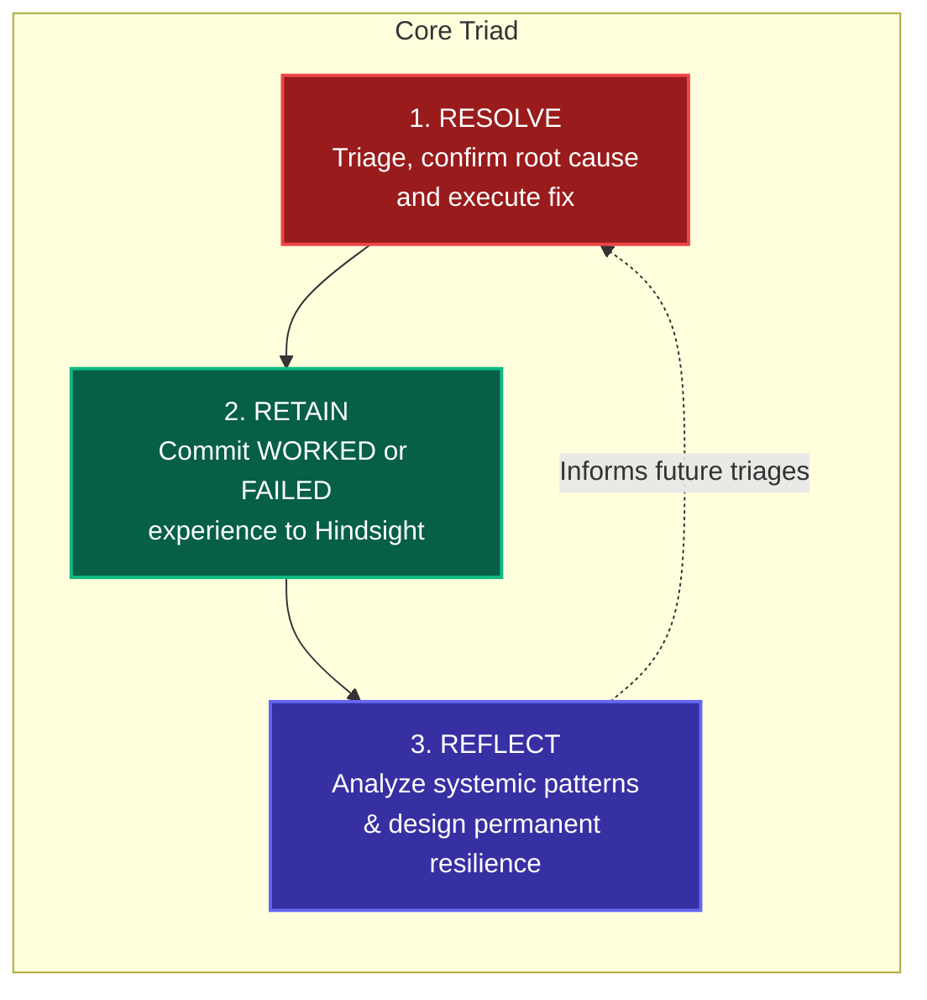

# 📖 OnCall Memory: Complete System Workflow & Hands-On Testing Guide
### *Memory-Augmented Autonomous Triage & Diagnostics with Hindsight & Groq LLM*

> **"When production breaks, the agent doesn't start from zero."**

---

## 📑 Document Overview

This document provides the definitive architectural workflow and step-by-step test guide for **OnCall Memory** (Incident Response Co-Pilot). It explains how every component functions across the entire operational lifecycle, details the **Resolve → Retain → Reflect** learning loop, and provides copy-pasteable test cases with exact inputs, execution steps (UI & API), and expected outcomes.

---

## 📑 Table of Contents
1. [Core Philosophy & High-Level Architecture](#1-core-philosophy--high-level-architecture)
2. [The Three Pillars: Resolve, Retain, Reflect](#2-the-three-pillars-resolve-retain-reflect)
3. [End-to-End Operational Lifecycle Workflow](#3-end-to-end-operational-lifecycle-workflow)
4. [User Interface Navigation & Interaction Map](#4-user-interface-navigation--interaction-map)
5. [Real Hands-On Test Cases](#5-real-hands-on-test-cases)
   - [Test Case 1: Cold-Start Triage (Brand New Incident / No Prior Memory)](#test-case-1-cold-start-triage-brand-new-incident--no-prior-memory)
   - [Test Case 2: Resolve & Retain (Closing the Learning Loop — WORKED Outcome)](#test-case-2-resolve--retain-closing-the-learning-loop--worked-outcome)
   - [Test Case 3: Re-occurrence & Instant Recall (Proves Biomimetic Learning)](#test-case-3-re-occurrence--instant-recall-proves-biomimetic-learning)
   - [Test Case 4: Negative Memory Protection (Surfacing a FAILED Anti-Pattern)](#test-case-4-negative-memory-protection-surfacing-a-failed-anti-pattern)
   - [Test Case 5: Side-by-Side Memory Contrast (Cold-Start vs. Hindsight Precision)](#test-case-5-side-by-side-memory-contrast-cold-start-vs-hindsight-precision)
   - [Test Case 6: Systemic Reflection & Resilience Engineering (Reflect & Prevent)](#test-case-6-systemic-reflection--resilience-engineering-reflect--prevent)
6. [API Quick Reference & PowerShell / Bash Commands](#6-api-quick-reference--powershell--bash-commands)
7. [System Health Verification & Diagnostics](#7-system-health-verification--diagnostics)

---

## 1. Core Philosophy & High-Level Architecture

In high-velocity production environments, oncall engineers encounter recurring incidents (pool exhaustion, memory leaks, certificate expirations, unindexed queries). Usually, past resolutions are buried in disconnected Slack threads, Jira tickets, or tribal knowledge. Engineers often repeat remedies that historically failed.

The **Oncall Incident Response Agent** solves this through a biomimetic memory architecture:
* **Hindsight Memory Engine (`oncall-memory`)**: Embedded, persistent vector/graph knowledge bank utilizing **TEMPR** retrieval (Temporal decay, Entity recognition, Meaning/semantic embeddings, and Keyword matching).
* **Groq Cloud LLM (`openai/gpt-oss-120b`)**: Sub-second reasoning that synthesizes incoming telemetry with recalled institutional memory into structured, actionable runbooks.
* **Closed-Loop Feedback**: Every confirmed resolution (both `WORKED` and `FAILED`) is permanently retained to refine future triage.
* **Deep Systemic Reflection**: Periodic or on-demand reflection identifies cross-service vulnerability patterns and formulates long-term architectural redesigns.

```text
┌────────────────────────────────────────────────────────────────────────┐
│                        React 19 + TypeScript UI                        │
│          (Served at port 8000 via FastAPI static mount / Vite 5173)    │
│  - Triage Input Form    - Hindsight Recall Inspector   - Compare View  │
│  - Resolve Modal        - Reflect & Prevent Workspace                  │
└───────────────────────────────────┬────────────────────────────────────┘
                                    │ HTTP / REST (/api/...)
┌───────────────────────────────────▼────────────────────────────────────┐
│                       FastAPI Backend (Python 3.11)                    │
│                                                                        │
│   ┌───────────────────────────────┼────────────────────────────────┐   │
│   ▼                               ▼                                ▼   │
│ [Config & Models]          [Agent Orchestrator]           [Seed Service]│
│  - Pydantic v2 schemas      - Recall past memories         - 12 Production │
│  - Env configuration        - Generate comparison           Incidents   │
│                             - Retain resolutions                       │
│                             - Systemic reflection                      │
│                                   │                                    │
│             ┌─────────────────────┴─────────────────────┐              │
│             ▼                                           ▼              │
│  ┌─────────────────────────┐               ┌─────────────────────────┐ │
│  │    Hindsight Service    │               │       LLM Service       │ │
│  │   (HTTP REST Client)    │               │       (Groq Cloud)      │ │
│  └──────────┬──────────────┘               └────────────┬────────────┘ │
└─────────────┼───────────────────────────────────────────┼──────────────┘
              │ Port 8888                                 │ HTTPS
              ▼                                           ▼
┌───────────────────────────┐               ┌───────────────────────────┐
│ Hindsight Memory Server   │               │   Groq Inference Cloud    │
│ (ghcr.io/vectorize-io)    │               │   (openai/gpt-oss-120b)   │
│ - Bank: "oncall-memory"   │               │ - Strict JSON Schema      │
│ - TEMPR Engine            │               │ - Sub-second generation   │
│ - Embedded pg0 + pgvector │               │                           │
│ - Local Embeddings/Rerank │               │                           │
└───────────────────────────┘               └───────────────────────────┘
```

---

## 2. The Three Pillars: Resolve, Retain, Reflect



### 1. RESOLVE (`POST /api/incidents/resolve`)
* When an outage strikes, the engineer diagnoses the issue with the agent co-pilot.
* Once mitigated, the engineer inputs the **Verified Root Cause**, **Applied Fix**, and specifies the **Outcome**:
  - **`WORKED`**: The action successfully mitigated the outage.
  - **`FAILED`**: The action proved ineffective, worsened downtime, or broke dependencies.

### 2. RETAIN (`POST /v1/default/banks/oncall-memory/memories`)
* The agent formats the resolution into a clean, canonical memory format:
  ```text
  [DATE] INCIDENT: <Title> | SERVICE: <Service> | ROOT CAUSE: <Cause> | FIX (WORKED or FAILED): <Fix details>
  ```
* The record is written permanently into Hindsight's `oncall-memory` bank.
* Future incidents touching this service or symptom profile will immediately recall this experience with high similarity scores.

### 3. REFLECT (`POST /api/incidents/reflect` & Hindsight native `/reflect`)
* Moves beyond immediate tactical fixes into proactive architectural engineering.
* Calls Hindsight's native `/reflect` endpoint to synthesize world facts, observed failure trends, and mental models from the bank.
* Groq synthesizes this into 5 resilience deliverables:
  1. **Systemic Root Cause**: The underlying architectural deficiency (e.g., absence of circuit breaking, unindexed unbounded queries).
  2. **Pattern Recognition**: How this incident relates to historical outages across other services.
  3. **Recurrent Risk**: What happens next if the system is left unpatched.
  4. **Architectural Redesign Fix**: Long-term structural hardening.
  5. **Prevention Runbook**: 4-step SRE preventive implementation checklist.

---

## 3. End-to-End Operational Lifecycle Workflow

```mermaid
sequenceDiagram
    autonumber
    actor Engineer as Oncall Engineer
    participant UI as React Frontend (:8000)
    participant API as FastAPI Backend (:8000)
    participant Hindsight as Hindsight Memory (:8888)
    participant Groq as Groq LLM Cloud

    %% Stage 1: Ingestion & Recall
    rect rgb(20, 20, 25)
    Note over Engineer, Groq: Phase 1: Telemetry Intake & Memory Recall
    Engineer->>UI: Selects Preset or Enters Telemetry (Title, Service, Logs)
    Engineer->>UI: Clicks "Analyze with Memory"
    UI->>API: POST /api/incidents/analyze
    API->>Hindsight: POST /v1/default/banks/oncall-memory/memories/recall
    Hindsight-->>API: Recalled Experiences (WORKED fixes, FAILED warnings, scores)
    API->>Groq: Synthesize Incident Telemetry + Recalled Evidence (Strict JSON)
    Groq-->>API: Structured Recommendation (Cause, Fix, Citations, Step-by-Step Runbook)
    API-->>UI: Return IncidentResponsePayload
    UI-->>Engineer: Render Runbook (Green Card) + Failed Fix Warnings (Red Badge)
    end

    %% Stage 2: Resolve & Retain
    rect rgb(15, 30, 20)
    Note over Engineer, Groq: Phase 2: Closed-Loop Resolution & Retention
    Engineer->>UI: Clicks "Resolve Incident & Retain"
    UI->>Engineer: Displays Resolution Modal
    Engineer->>UI: Submits Root Cause, Applied Fix, and Outcome (WORKED / FAILED)
    UI->>API: POST /api/incidents/resolve
    API->>Hindsight: POST /v1/default/banks/oncall-memory/memories (retain canonical string)
    Hindsight-->>API: Success (200 OK)
    API-->>UI: ResolutionConfirmation { status: "retained" }
    UI-->>Engineer: Emerald Toast "Incident Resolution Retained into Hindsight!"
    end

    %% Stage 3: Reflection & Long-Term Resilience
    rect rgb(20, 15, 30)
    Note over Engineer, Groq: Phase 3: Systemic Reflection & Resilience Redesign
    Engineer->>UI: Clicks "Reflect & Prevent"
    UI->>API: POST /api/incidents/reflect
    API->>Hindsight: POST /v1/default/banks/oncall-memory/reflect (fetch observations)
    Hindsight-->>API: Reflected Insights & Memory Trends
    API->>Groq: Generate Post-Mortem & Resilience Analysis
    Groq-->>API: ReflectionAnalysis (Systemic Cause, Risks, Architectural Fix, Runbook)
    API-->>UI: Return ReflectResponsePayload
    UI-->>Engineer: Render Deep Reflection Workspace with SRE Prevention Plan
    end
```



---

## 4. User Interface Navigation & Interaction Map

The web dashboard is hosted at **`http://localhost:8000`**.

```text
┌──────────────────────────────────────────────────────────────────────────────────────────────────┐
│  [🤖 Logo] Incident Response Agent                               [Bank: oncall-memory] [Seed DB] │
├──────────────────────────────────────────────────────────────────────────────────────────────────┤
│  CORE PROGRESSION:  [1. Resolve Incident]  ──▶  [2. Retain Knowledge]  ──▶  [3. Reflect & Prevent]│
├──────────────────────────────────────────┬───────────────────────────────────────────────────────┤
│  INCIDENT INGESTION FORM                 │  WORKSPACES (Switchable Tabs):                        │
│  - Select Preset Scenario: [Dropdown ▼]  │  [⚡ Recommendation] [⚖️ Compare Modes] [🔮 Reflect]  │
│  - Incident Title                        │                                                       │
│  - Affected Service                      │  ┌─────────────────────────────────────────────────┐ │
│  - Description                           │  │ 🌿 Green Recommendation Card: Verified Fix       │ │
│  - Observed Symptoms                     │  │ 🚨 Critical Anti-Pattern: What FAILED in past    │ │
│  - Raw Error Logs                        │  │ 📋 Step-by-Step Triage Runbook                  │ │
│                                          │  │ 🏷️ Recalled Memory Citations (Dates & Scores)   │ │
│  [⚡ Analyze with Memory]                 │  └─────────────────────────────────────────────────┘ │
│  [⚖️ Compare Modes]                      │  [ Resolve Incident & Retain Button ]                 │
│  [🔮 Reflect & Prevent]                  │                                                       │
└──────────────────────────────────────────┴───────────────────────────────────────────────────────┘
```

### Key UI Controls:
1. **Logo & Status Header**: Displays Hindsight connection status, LLM model in use, and the **"Seed Knowledge Bank"** button to load 12 initial incident precedents.
2. **Interactive Progression Stepper**:
   - Step 1: **Resolve Incident** (Guides triage and mitigation).
   - Step 2: **Retain Knowledge** (Opens the resolution dialog to save learnings).
   - Step 3: **Reflect & Prevent** (Triggers systemic post-mortem analysis).
3. **Preset Dropdown**: Allows instant 1-click loading of realistic production outage scenarios.
4. **Three Action Buttons**:
   - **`Analyze with Memory`**: Recalls relevant past experiences and outputs a prioritized runbook.
   - **`Compare Modes`**: Runs simultaneous triage with vs. without memory to showcase the difference.
   - **`Reflect & Prevent`**: Initiates Hindsight native reflection to discover systemic architecture flaws.
5. **View Switcher Tabs**: Once an incident is analyzed, toggle between **Recommendation**, **Comparison**, and **Reflect** views without losing context.
6. **Resolve Modal**: Accessible via the prominent **"Resolve Incident & Retain"** button on the recommendation card or via the header stepper.

---

## 5. Real Hands-On Test Cases

### 🌟 Featured Live Demo: Login Service — Database Connection Error (New Incident Cold-Start)

#### Goal:
Demonstrate how the agent safely handles a new incident on `login-service`. Even though historical memories exist for other microservices (such as `order-service` database pool saturation), the agent respects service boundaries, avoids attributing unrelated historical fixes, and provides calibrated, cautious exploratory guidance.

#### Input Details (Available as 1-Click Preset in UI):
* **Preset Selection**: `Login Service — Database Connection Error`
* **Title**: `Login Service Database Connection Error`
* **Service**: `login-service`
* **Description**: `Users are unable to log in.`
* **Symptoms**: `Database connections are exhausted, and login requests are timing out.`
* **Error Logs**: `Connection is not available, request timed out`

#### Step-by-Step UI Execution:
1. Open the UI at `http://localhost:8000` (or `http://localhost:5173`).
2. In the **"Demo Scenario"** dropdown, select **"Login Service — Database Connection Error"**.
3. All incident fields auto-populate.
4. **Action**: Click **"Analyze with Memory"**.

#### PowerShell / Curl Execution:
```powershell
curl.exe -s -X POST http://localhost:8000/api/incidents/analyze `
  -H "Content-Type: application/json" `
  -d '{\"title\":\"Login Service Database Connection Error\",\"service\":\"login-service\",\"description\":\"Users are unable to log in.\",\"symptoms\":\"Database connections are exhausted, and login requests are timing out.\",\"error_logs\":\"Connection is not available, request timed out\"}'
```

#### Expected Result:
* **Memory Search**: The agent searches Hindsight memory bank (`oncall-memory`).
* **Service Boundary Guard**: Because this is a new incident for `login-service`, unrelated `order-service` memories (like `OrderPaymentProcessor` or webhook circuit breaker) are **NOT** treated as verified matches.
* **Calibrated Confidence**: Displays **`LOW`** (or cautious **`MEDIUM`** if cross-service conceptual patterns are detected) rather than false high confidence.
* **Recommended Runbook**: Cautiously suggests checking database connections, connection pool limits, active transaction leaks, and query timeouts for `login-service`.
* **Citing**: Explicitly notes: *"No historical incident memories found for login-service. Starting from baseline."*

---

### Test Case 1: Cold-Start Triage (Brand New Incident / No Prior Memory)

#### Goal:
Demonstrate the agent's baseline behavior when encountering an incident with zero prior records in the memory bank.

#### Input Data:
* **Preset Name**: `Elasticsearch CircuitBreakingException (Demo Stage 1: Cold Start)`
* **Title**: `Elasticsearch CircuitBreakingException on Query Node`
* **Service**: `search-indexer`
* **Description**: `Catalog search queries failing with 500 error. Search indexer node heap memory saturated.`
* **Symptoms**: `Elasticsearch cluster state Yellow. Search latency up to 8s, parent circuit breaker tripping.`
* **Error Logs**:
  ```text
  org.elasticsearch.common.breaker.CircuitBreakingException: [parent] Data too large, data for [<transport_request>] would be [1048576000/1000mb], which is larger than the limit of [996147200/950mb]
  ```

#### Step-by-Step UI Execution:
1. Open `http://localhost:8000`.
2. In the **"Select Preset Incident"** dropdown, select **"Elasticsearch CircuitBreakingException (Demo Stage 1: Cold Start)"**.
3. Notice the input fields auto-populate.
4. Click **"Analyze with Memory"**.

#### PowerShell / Curl Execution:
```powershell
curl.exe -s -X POST http://localhost:8000/api/incidents/analyze `
  -H "Content-Type: application/json" `
  -d '{\"title\":\"Elasticsearch CircuitBreakingException on Query Node\",\"service\":\"search-indexer\",\"description\":\"Catalog search queries failing with 500 error. Search indexer node heap memory saturated.\",\"symptoms\":\"Elasticsearch cluster state Yellow. Search latency up to 8s, parent circuit breaker tripping.\",\"error_logs\":\"org.elasticsearch.common.breaker.CircuitBreakingException: [parent] Data too large\"}'
```

#### Expected Outcome:
* **Recalled Memories Card**: Displays *"No prior memory records found for this specific query"* or low similarity score.
* **Confidence Level**: **Low / Medium (35% - 50%)**.
* **Recommendation**: Proposes generic diagnostic steps (inspecting node garbage collection, verifying heap sizing, checking slow logs).
* **Historical Citations**: None listed.

---

### Test Case 2: Resolve & Retain (Closing the Learning Loop — WORKED Outcome)

#### Goal:
Mitigate the outage from Test Case 1 and permanently retain the solution into Hindsight memory.

#### Input Data:
* **Incident Title**: `Elasticsearch CircuitBreakingException on Query Node`
* **Service**: `search-indexer`
* **Root Cause**: `Unbounded aggregations on unindexed field payload.details saturated JVM heap`
* **Fix Applied**: `Set indices.breaker.total.use_real_memory: false and clamped terms aggregation max_size=50`
* **Outcome**: `WORKED`

#### Step-by-Step UI Execution:
1. Continuing from Test Case 1, click the emerald green button: **"Resolve Incident & Retain"** (or click Step 2 in the top progression bar).
2. The **"Resolve Incident & Retain Knowledge"** modal opens.
3. Fill in the fields:
   - **Root Cause**: `Unbounded aggregations on unindexed field payload.details saturated JVM heap`
   - **Fix Description**: `Set indices.breaker.total.use_real_memory: false and clamped terms aggregation max_size=50`
   - **Outcome**: Ensure **"Fix WORKED (Confirmed Solution)"** is selected.
4. Click **"Confirm & Retain in Hindsight"**.

#### PowerShell / Curl Execution:
```powershell
curl.exe -s -X POST http://localhost:8000/api/incidents/resolve `
  -H "Content-Type: application/json" `
  -d '{\"incident_title\":\"Elasticsearch CircuitBreakingException on Query Node\",\"service\":\"search-indexer\",\"root_cause\":\"Unbounded aggregations on unindexed field payload.details saturated JVM heap\",\"fix_description\":\"Set indices.breaker.total.use_real_memory: false and clamped terms aggregation max_size=50\",\"outcome\":\"WORKED\"}'
```

#### Expected Outcome:
* Modal displays green celebration card: *"Incident Resolution Retained into Hindsight Memory Bank 'oncall-memory'!"*.
* HTTP Response:
  ```json
  {
    "status": "retained",
    "bank_id": "oncall-memory",
    "retained_text": "[<CURRENT_DATE>] INCIDENT: Elasticsearch CircuitBreakingException on Query Node | SERVICE: search-indexer | ROOT CAUSE: Unbounded aggregations on unindexed field payload.details saturated JVM heap | FIX (WORKED): Set indices.breaker.total.use_real_memory: false and clamped terms aggregation max_size=50"
  }
  ```
* The memory is immediately committed to the persistent Docker volume.

---

### Test Case 3: Re-occurrence & Instant Recall (Proves Biomimetic Learning)

#### Goal:
Show that when a similar incident fires on any cluster node, the agent immediately recalls the solution retained in Test Case 2 with high confidence.

#### Input Data:
* **Preset Name**: `Parent Circuit Breaker Tripped (Demo Stage 2: Learned Fix)`
* **Title**: `Parent Circuit Breaker Tripped on Search Cluster`
* **Service**: `search-indexer`
* **Description**: `Search queries crashing again with CircuitBreakingException under moderate load.`
* **Symptoms**: `Heap parent circuit breaker triggered on query transport request.`
* **Error Logs**:
  ```text
  org.elasticsearch.common.breaker.CircuitBreakingException: [parent] Data too large for [<transport_request>]
  ```

#### Step-by-Step UI Execution:
1. On `http://localhost:8000`, select preset: **"Parent Circuit Breaker Tripped (Demo Stage 2: Learned Fix)"**.
2. Click **"Analyze with Memory"**.

#### PowerShell / Curl Execution:
```powershell
curl.exe -s -X POST http://localhost:8000/api/incidents/analyze `
  -H "Content-Type: application/json" `
  -d '{\"title\":\"Parent Circuit Breaker Tripped on Search Cluster\",\"service\":\"search-indexer\",\"description\":\"Search queries crashing again with CircuitBreakingException under moderate load.\",\"symptoms\":\"Heap parent circuit breaker triggered on query transport request.\",\"error_logs\":\"org.elasticsearch.common.breaker.CircuitBreakingException: [parent] Data too large for [<transport_request>]\"}'
```

#### Expected Outcome:
* **Confidence Level**: Jumps to **High (90% - 95%)**.
* **Recalled Memories Card**: Immediately displays the exact memory retained in Test Case 2 with an emerald **"WORKED"** badge and high similarity score.
* **Likely Root Cause**: Accurately diagnoses `Unbounded aggregations on unindexed field payload.details`.
* **Recommended Runbook**: Directly instructs setting `indices.breaker.total.use_real_memory: false` and clamping aggregation size to 50.
* **Historical Citations**: Cites the exact incident recorded minutes earlier.

---

### Test Case 4: Negative Memory Protection (Surfacing a FAILED Anti-Pattern)

#### Goal:
Verify that the agent warns engineers against taking actions that historically failed and caused recurring outages.

#### Input Data:
* **Preset Name**: `Database Connection Pool Exhausted`
* **Title**: `Database Connection Pool Exhausted`
* **Service**: `order-service`
* **Description**: `users-db connection pool at 100% capacity. New connections failing with timeout errors. Database queries experiencing 500ms+ latency.`
* **Symptoms**: `Database connection pool utilization at 100%, p99 latency spike to 12s, cart abandonment rate spiked 400%.`
* **Error Logs**:
  ```text
  org.springframework.dao.CannotAcquireLockException: HikariPool-1 - Connection is not available, request timed out after 30005ms.
  Caused by: java.sql.SQLTransientConnectionException: Connection pool exhausted.
  ```

#### Step-by-Step UI Execution:
1. Select preset: **"Database Connection Pool Exhausted"**.
2. Click **"Analyze with Memory"**.

#### PowerShell / Curl Execution:
```powershell
curl.exe -s -X POST http://localhost:8000/api/incidents/analyze `
  -H "Content-Type: application/json" `
  -d '{\"title\":\"Database Connection Pool Exhausted\",\"service\":\"order-service\",\"description\":\"users-db connection pool at 100% capacity. New connections failing with timeout errors.\",\"symptoms\":\"Database connection pool utilization at 100%, p99 latency spike to 12s.\",\"error_logs\":\"org.springframework.dao.CannotAcquireLockException: HikariPool-1 - Connection is not available, request timed out after 30005ms.\"}'
```

#### Expected Outcome:
* **Critical Anti-Pattern Warning**: A prominent red alert card appears:
  > **⚠️ CRITICAL: PREVIOUSLY FAILED REMEDY DETECTED**  
  > *"Restarting order-service pods FAILED on 04 May 2026. Connections saturated again within 90 seconds, causing recurring checkout 500s and dropping inflight carts."*
* **Verified Worked Fix**: Highlights wrapping third-party payment webhooks in a 2-second circuit breaker and setting `leakDetectionThreshold=2000ms`.
* **Zero Wasted Time**: Prevents the engineer from rebooting pods and compounding the outage.

---

### Test Case 5: Side-by-Side Memory Contrast (Cold-Start vs. Hindsight Precision)

#### Goal:
Showcase the dramatic difference in triage accuracy and time-to-resolution between unassisted LLM guesswork and Hindsight-augmented precision.

#### Input Data:
* **Preset Name**: `Redis Eviction Spike & Cache Miss Storm`
* **Title**: `Redis Eviction Spike & Cache Miss Storm`
* **Service**: `cache-service`
* **Description**: `Redis cluster memory hit maxmemory 98%. Eviction rate spiked 10,000 keys/sec causing downstream database surge.`
* **Symptoms**: `Eviction rate spiked, cache miss rate jumped to 85%, backend RDS CPU at 95%.`
* **Error Logs**:
  ```text
  OOM command not allowed when used memory > 'maxmemory'. Eviction loop active.
  ```

#### Step-by-Step UI Execution:
1. Select preset: **"Redis Eviction Spike & Cache Miss Storm"**.
2. Click the button: **"Compare: Without vs. With Memory"**.
3. View the split comparison columns.

#### PowerShell / Curl Execution:
```powershell
curl.exe -s -X POST http://localhost:8000/api/incidents/compare `
  -H "Content-Type: application/json" `
  -d '{\"title\":\"Redis Eviction Spike & Cache Miss Storm\",\"service\":\"cache-service\",\"description\":\"Redis cluster memory hit maxmemory 98%. Eviction rate spiked 10,000 keys/sec.\",\"symptoms\":\"Eviction rate spiked, cache miss rate jumped to 85%.\",\"error_logs\":\"OOM command not allowed when used memory > maxmemory\"}'
```

#### Expected Outcome:
* **Left Column (Without Memory — Cold Start Guesswork)**:
  - Red-themed card.
  - Confidence: **Low (40%)**.
  - Recommendation: Suggests generic actions like flushing keys, scaling cluster nodes, or restarting instances.
  - No historical context.
* **Right Column (With Hindsight Memory — Proven Solution)**:
  - Green-themed card.
  - Confidence: **High (95%)**.
  - Recommendation: Pinpoints setting `maxmemory-policy volatile-lru` and enforcing a strict 1800s TTL clamp on unexpired session tokens.
  - Recalls past cache eviction precedent from `08 May 2026`.
* **Contrast Summary Card**: Outlines how memory eliminated trial-and-error and identified the exact configuration parameter immediately.

---

### Test Case 6: Systemic Reflection & Resilience Engineering (Reflect & Prevent)

#### Goal:
Execute Hindsight's native `/reflect` engine to synthesize failure trends across the knowledge bank and formulate an architectural resilience roadmap.

#### Input Data:
* **Title**: `Database Connection Pool Exhausted`
* **Service**: `order-service`
* **Description**: `users-db connection pool at 100% capacity. New connections failing with timeout errors.`
* **Symptoms**: `Database connection pool utilization at 100%, p99 latency spike to 12s.`
* **Error Logs**:
  ```text
  CannotAcquireLockException: HikariPool-1 - Connection is not available, request timed out after 30005ms.
  ```

#### Step-by-Step UI Execution:
1. Select preset: **"Database Connection Pool Exhausted"** (or enter the data manually).
2. Click **"Reflect & Prevent"** (or click Step 3 in the progression bar).
3. The dashboard switches to the **"🔮 Reflect"** tab.

#### PowerShell / Curl Execution:
```powershell
curl.exe -s -X POST http://localhost:8000/api/incidents/reflect `
  -H "Content-Type: application/json" `
  -d '{\"title\":\"Database Connection Pool Exhausted\",\"service\":\"order-service\",\"description\":\"users-db connection pool at 100% capacity. New connections failing with timeout errors.\",\"symptoms\":\"Database connection pool utilization at 100%, p99 latency spike to 12s.\",\"error_logs\":\"CannotAcquireLockException: HikariPool-1 - Connection is not available, request timed out after 30005ms.\"}'
```

#### Expected Outcome:
The UI renders a 2-column systemic post-mortem analysis:
1. **Systemic Root Cause**: Identifies architectural deficiency (synchronous blocking database transactions dependent on un-bounded third-party HTTP webhooks).
2. **Cross-Service Pattern Recognition**: Detects that `order-service` and `payment-service` share common thread exhaustion patterns when upstream payment gateways degrade.
3. **Recurrent Failure Risk**: Explains that without asynchronous decoupling, any third-party latency spike will trigger a complete cascade of downstream cart dropouts.
4. **Architectural Redesign Fix**: Provides a comprehensive blueprint (e.g., Decouple checkout transaction from payment settlement via transactional outbox pattern and Kafka message queue).
5. **SRE Prevention Runbook**:
   - Step 1: Configure circuit breaker with 2s timeout on all external API clients.
   - Step 2: Implement HikariCP `leakDetectionThreshold=2000ms`.
   - Step 3: Establish synthetic heartbeat probe monitoring connection acquisition latency.
   - Step 4: Add Kubernetes autoscaling rule on JDBC active connections.
6. **Hindsight Reflected Memory Evidence**: Displays the specific historical incidents cited by the memory engine during reflection.

---

## 6. API Quick Reference & PowerShell / Bash Commands

| Endpoint | Method | Purpose | Key Payload Fields |
|---|---|---|---|
| `/api/health` | `GET` | System & Bank Connectivity | *None* |
| `/api/presets` | `GET` | Retrieve 8 Demo Scenarios | *None* |
| `/api/incidents/analyze` | `POST` | Triage & Memory Recall | `title`, `service`, `description`, `symptoms`, `error_logs` |
| `/api/incidents/compare` | `POST` | With vs. Without Memory | `title`, `service`, `description`, `symptoms`, `error_logs` |
| `/api/incidents/resolve` | `POST` | Retain Solution into Bank | `incident_title`, `service`, `root_cause`, `fix_description`, `outcome` |
| `/api/incidents/reflect` | `POST` | Deep Systemic Reflection | `title`, `service`, `description`, `symptoms`, `error_logs` |
| `/api/seed` | `POST` | Seed 12 Historical Outages | *None* |

### Quick Test Script (Python):
Run this single command from your terminal to verify all core endpoints end-to-end:
```powershell
python -c "import urllib.request, json; print('Health:', json.loads(urllib.request.urlopen('http://localhost:8000/api/health').read())['status'])"
```

---

## 7. System Health Verification & Diagnostics

### 1. Check Container Health
```powershell
docker compose ps
```
Both containers (`hindsight` and `incident-response-agent`) should show status `Up` / `healthy`.

### 2. Stream Live Logs
```powershell
# View both application and memory logs in real time
docker compose logs -f
```

### 3. Run Automated Pytest Suite
```powershell
cd backend
python -m pytest tests -v -o pythonpath=.
```
Expected output: **6/6 tests passing** (including formatting, seed validation, retain/recall integration, comparison contrast, and reflection).

---

<p align="center">
  <b>Built for reliable, continuous-learning incident operations.</b>
</p>
